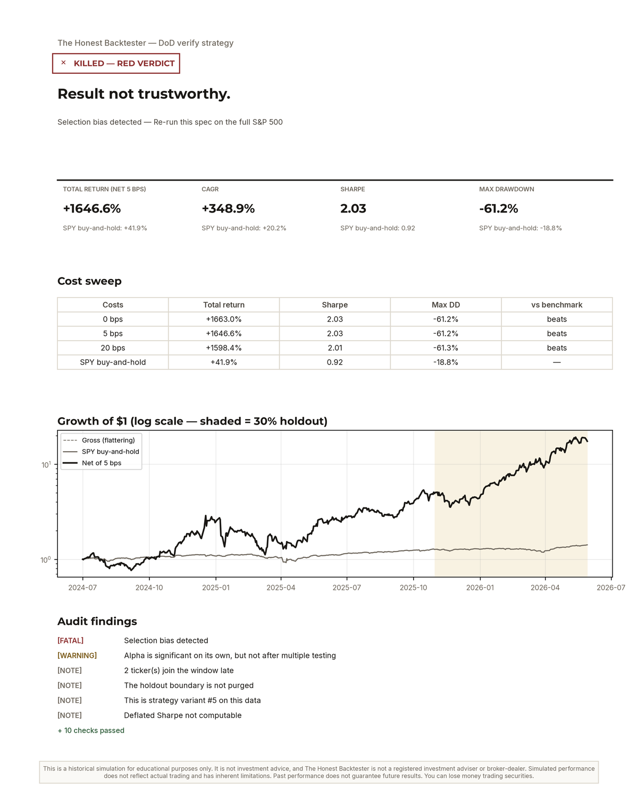
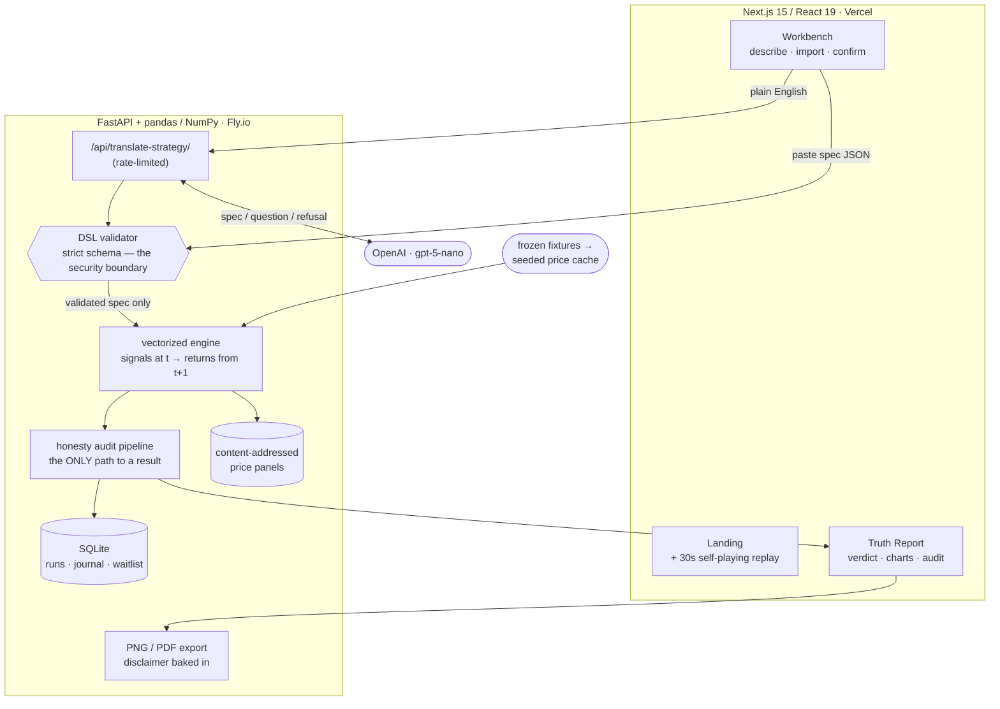

# The Honest Backtester

Describe a trading strategy in plain English → get a backtest that actively
tries to kill it: bias audits, cost sweeps, and an always-on benchmark on
every single result. *The backtester that tries to kill your strategy before
the market does.*

Born from a real session: a first momentum backtest said **+1650%** (136% a
year, February 2023 to May 2026), on 44 tickers picked with hindsight and with
a 45% drawdown against SPY's 8%. A stricter strategy on the full S&P 500
(momentum plus low volatility, top 25 names, 2016 to 2026) made +163% and
**lost to SPY buy-and-hold** (+362%). A dip-buying strategy beat SPY on Sharpe
before costs (1.05 vs 0.83); at 5 bps a day it was still up 103% but trailed
SPY's 344%. Every existing retail tool would have shown the first number and
none of the corrections. This one shows the corrections first.

> **Educational research tool. Past performance does not predict future
> results. Not investment advice.** No trade execution, no signals — ever.

**Live:** [honest-backtester-six.vercel.app](https://honest-backtester-six.vercel.app)
 · **Stack:** Next.js 15 (React 19, TypeScript) · FastAPI · pandas/NumPy ·
SQLite · matplotlib · an LLM translation layer (multi-provider)

Every run ends in a **Truth Report** — the verdict first, the benchmark always,
the flattering number second:



## Engineering highlights

- **The honesty audit is the product, and it can't be turned off.** Every result
  runs a gauntlet — selection-bias re-run on the full index, a cost sweep at
  0/5/20 bps, a 70/30 train/holdout split the verdict is computed on, regime
  coverage, parameter-sensitivity, capacity, and a multiple-testing counter —
  and the benchmark is shown on every single result.
- **A constrained JSON DSL is the security boundary.** Plain English is
  translated by an LLM into a strict, validated spec (`extra="forbid"`); the
  engine executes *that*, never model output or arbitrary code, so there is no
  eval/exec surface. The LLM never silently guesses a material parameter — it
  asks, or refuses.
- **Point-in-time correct by construction.** Signals at day *t* earn returns
  from *t+1* (the shift lives inside the engine, not in convention), so altering
  future prices cannot change past weights — verified by a regression test.
- **Byte-for-byte reproducible.** Every run freezes its exact price panel under
  a content hash and replays it; panels are content-addressed, so identical
  runs share one stored blob instead of duplicating megabytes.
- **Deterministic, not model-generated, prose.** The plain-English readback and
  the audit findings are rendered by template code from the same day-count
  conventions the engine uses — one source of truth, no hallucinated numbers.
- **Measured, not vibes.** A provider-agnostic LLM layer with a cost/accuracy
  bench; 130+ backend tests including hand-computed golden fixtures and an
  adversarial audit of the engine's own arithmetic (see `DECISIONS.md`).

> The live link's landing page includes a self-playing 30-second replay of a
> real run. The interactive app runs locally — the hosted engine may be asleep.

## Quickstart (macOS)

Prereqs: Python 3.11 (`brew install python@3.11`), Node 18+ (`brew install node`).

```bash
# 1. One-time: seed the offline price cache from the frozen fixtures (~30s)
make seed

# 2. Optional — only needed for plain-English → spec translation:
cp .env.example .env    # add any provider key: OpenAI / Anthropic / Gemini

# 3. Run everything (backend :8000, frontend :3000) with one command
make dev
```

Open **http://localhost:3000**. Backend API docs at `/docs` on the backend
port `dev.sh` prints (8000, or the first free fallback).

- If port 8000 is busy, `dev.sh` falls back to 8010/8020/8030 automatically
  and points the frontend at the right port (`HONEST_BACKEND_PORT` overrides).
- The engine, honesty audits, journal, exports, and re-runs all work **fully
  offline** on the seeded fixtures. Without an API key the home page offers a
  paste-a-spec-JSON path instead of translation.

## Tests

```bash
make test    # golden + property + audit + API tests, then frontend typecheck
make eval    # live LLM translation eval harness (needs a provider API key):
             # ≥90% exact-match on spec cases, 100% on clarify/refuse cases
```

The engine's golden fixtures are hand-computed with exact fraction arithmetic
and were independently recomputed by a separate audit (see `DECISIONS.md`).

## How it works

```
plain English ──LLM (any provider)─▶ spec JSON or clarifying questions
                                      │  (never guesses material params)
                        deterministic validator  ← the security boundary
                                      │  (only validated DSL ever runs)
                          YOU confirm the spec card ("Run the gauntlet")
                                      │
                 frozen parquet snapshot (SHA-256 content hash)
                                      │
              vectorized engine (signals at t → returns from t+1)
                                      │
        THE HONESTY AUDIT — always, no toggle:  selection bias (neutral
        re-run) · cost sweep 0/5/20 bps · regime coverage · 70/30 holdout ·
        parameter sensitivity · benchmark fit · capacity · multiple-testing
        counter · data-quality disclosures · lookahead impossibility
                                      │
                    Truth Report (verdict first, benchmark always)
```

**Non-negotiables baked into the code:**
- There is no route or function that runs a backtest without the full audit.
- The benchmark appears on every result and inside every exported artifact.
- No arbitrary code execution — the LLM only emits JSON against a closed
  schema; unknown fields are rejected, never ignored.
- The plain-English readback on the spec card is generated by template code
  from the validated JSON, never by the model that produced it.
- Data problems (exclusions, gaps, shortened windows, stale cache) surface as
  findings, never silently.
- The verdict always quotes the pessimistic cell: net-of-costs, holdout
  segment. A ranked strategy on a hand-picked universe can never earn green.

## Architecture



The frontend is a static Next.js deploy; the FastAPI backend holds the engine,
the audit, and the data. The **validator is the trust boundary** — the LLM only
ever emits JSON against a closed schema, and only a *validated* spec reaches the
engine, so there is no arbitrary-code path. Price data is served from
fixture-seeded parquet (deterministic, offline), and every run freezes a
content-hashed panel it can replay byte-for-byte.

## Repository layout

```
├── Makefile / dev.sh          # dev, test, eval, seed
├── backend/
│   ├── main.py                # FastAPI app + routers
│   ├── config.py              # settings; provider API key via .env only
│   ├── dsl/                   # schema (Pydantic), validator, conventions
│   │   │                      #   (single source of truth for day counts),
│   │   ├── readback.py        #   deterministic English readback
│   │   ├── universes.py       #   presets from checked-in seed lists
│   │   └── symbols.py         #   symbol master + typo suggestions
│   ├── engine/                # calendar, signals, vectorized backtest,
│   │   │                      #   metrics, data layer + snapshots
│   ├── audit/                 # every check + pipeline.build_report (the
│   │                          #   ONLY path to a result) + verdict rollup
│   ├── llm/                   # translator + versioned prompt
│   ├── routes/                # specs, translate, runs (SSE), journal, exports
│   ├── store/                 # SQLite via SQLAlchemy, plain-SQL migrations,
│   │                          #   local event log (never third-party)
│   └── tests/                 # golden, property, audit, API, eval harness
├── frontend/                  # Next.js App Router: describe → confirm →
│   │                          #   Truth Report; journal; compare; glossary
├── fixtures/                  # frozen price panels + constituent seed lists
│   │                          #   (source + snapshot date in each header)
├── scripts/                   # seed_cache.py, refresh_universes.py
└── data/                      # gitignored: DB, price cache, run snapshots
```

## Reproducibility (Gap #2)

Every run freezes the exact price panel it used to
`data/runs/<run_id>/panel.parquet` with a SHA-256 content hash stored on the
run. **Re-running a saved strategy replays the snapshot by default** and
reproduces the report's metrics byte-for-byte (tested). "Refresh data & run"
is the only path to new numbers. yfinance restates adjusted prices over time
— that's why the journal's compare view shows each run's snapshot hash.

## Adding a DSL block (how to extend)

1. **Schema** — add the field/enum in `backend/dsl/schema.py` (keep
   `extra="forbid"`), bump nothing: `spec_version` only changes on breaking
   shape changes.
2. **Validation** — semantic rules in `backend/dsl/validator.py`; reject
   anything the engine would silently ignore.
3. **Engine** — implement in `backend/engine/signals.py` (backward-looking
   ops only; add it to the future-perturbation test in `test_golden.py`) or
   `backtest.py`.
4. **Conventions** — document the exact formula in
   `backend/dsl/conventions.py`; the LLM prompt and glossary render from it.
5. **Prompt + evals** — describe it in `backend/llm/prompts/translator_v1.md`
   (new prompt version if behavior changes) and add eval cases in
   `backend/tests/eval_cases.json`.
6. **Tests** — a golden fixture if it touches money math.

## Data honesty in V0 (known limitations)

- **Universe presets use current index members** (checked-in seed lists from
  Wikipedia with snapshot dates; `scripts/refresh_universes.py` refreshes).
  Current-members lists are survivor-loaded; every report discloses this and
  extreme outperformance on them is capped at an amber verdict. True
  point-in-time membership needs licensed data (V1).
- **yfinance** is fine for personal research, not for a commercial product
  (ToS + survivorship). The V1 path is licensed survivorship-free data.
- **No market-cap/ADV data** — the wide-spread warning is a heuristic
  disclosure, not a measurement.
- Daily bars only; long-only; US equities + ETFs.

## Troubleshooting

- **"no price data available"** → run `make seed`.
- **Translation returns 503** → set a provider key (`OPENAI_API_KEY` etc.) in `.env`; everything
  except translation works without it.
- **yfinance rate-limited** → runs fall back to the cache automatically and
  the report is stamped "data as of <date> (cached)".
- **Port 8000 taken** → automatic fallback; or `HONEST_BACKEND_PORT=8020 make dev`.

See `DECISIONS.md` for every ambiguity resolution and the adversarial-audit
fix log, and `PRODUCT_BRIEF.md` for the full product spec.
